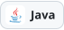
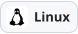

<picture>
  <source media="(prefers-color-scheme: dark)" srcset="assets/yrok-dark.svg">
  <source media="(prefers-color-scheme: light)" srcset="assets/yrok-light.svg">
  
</picture>

## 안녕하세요, 오영록입니다 🐣

```js
const yrok = {
  name: "오영록",
  school: "동양미래대학교",
  major: "인공지능소프트웨어학과",
  now: "여러 프로그램 만드는 중",
};
```

<p>
  <a href="https://www.instagram.com/04_rok/"></a>
</p>

## 🧰 기술

**언어**

<p>
  
  
  
  
  
  
</p>

**서버 · 데이터**

<p>
  
  
  
  
  
</p>

**환경 · 도구**

<p>
  
  
  
  
  
  
  
  
  
</p>

## 📦 프로젝트

<!-- 새 프로젝트는 아래 목록에 세 줄씩 더하면 돼요. -->

- **[HEART SYNC](https://github.com/20232497/HEARTSYNC)**  
  캐릭터 대화형 에피소드 플랫폼  
  `JavaScript` `Supabase`
